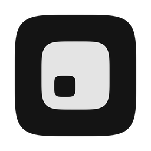

<div align="center">
  
  <h1>Rokk</h1>
  <p>A calm terminal for people who build with Claude Code.</p>
</div>

## Status

Rokk is at a very early stage. Right now it is Terax under a new name and icon. Rokk's own features are still being built, and nothing here is ready for daily use.

## Run it

Prereqs: Rust (stable), Node 22+, pnpm, and the [Tauri prerequisites](https://tauri.app/start/prerequisites/) for your platform.

```bash
pnpm install
pnpm tauri dev
```

## Credits and license

Rokk is based on [Terax](https://github.com/crynta/Terax-AI) and is licensed under the [Apache License 2.0](LICENSE). See [NOTICE](NOTICE) for attribution and [docs/rokk/CHANGES.md](docs/rokk/CHANGES.md) for the list of changes. The original Terax README is kept at [docs/rokk/UPSTREAM_README.md](docs/rokk/UPSTREAM_README.md).

Rokk is an independent project. It is not affiliated with, endorsed by or sponsored by Terax, its maintainers, or Anthropic.
